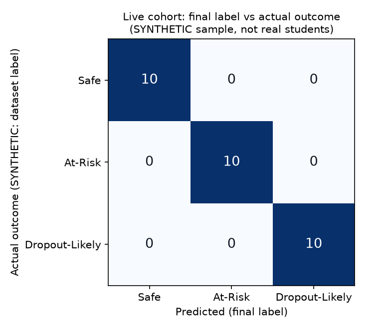

# Live-data evaluation

Generated 2026-11-07 18:31 by `evaluation/live_eval.py`.

> **Data source: SYNTHETIC sample (evaluation/sample_live_cohort.csv) - NOT real student data.** Cohort file(s): `sample_live_cohort.csv`.
> These 30 students were drawn from the synthetic training dataset (stratified 10 per label), because no real
> classroom file exists yet. The model's train/test split was not saved, so they are probably rows the model
> was trained on, and their "actual outcome" is the dataset's policy-derived label. **These numbers test the
> live-data pipeline end to end; they say nothing about accuracy on real students.**

## Overview

- Sample size: **30** live students with a prediction (30 live students in total).
- Prediction source: model 30, rule fallback 0.
- Final labels: Safe 10, At-Risk 10, Dropout-Likely 10.
- Model vs policy agreement: **27/30 (90.0%)**; the policy raised 0 label(s).
- Inputs taken from live data (per student): Attendance_Percentage 30.
- Inputs missing in the cohort file (imputed by the pipeline - median / most frequent of the training data): Age 30, Assignment_Submission_Rate 30, Gender 30, Hostel 30, LMS_Login_Count 30, Scholarship 30, Study_Hours_Per_Week 30.

## Confusion matrix and per-class scores

Compared against `actual_outcome` from the cohort file, present for 30 of 30 students. For this SYNTHETIC sample it is the dataset's policy-derived Target_Label, not an observed outcome.

| truth \ predicted | Safe | At-Risk | Dropout-Likely |
|---|---:|---:|---:|
| **Safe** | 10 | 0 | 0 |
| **At-Risk** | 0 | 10 | 0 |
| **Dropout-Likely** | 0 | 0 | 10 |

| class | precision | recall | F1 | support |
|---|---:|---:|---:|---:|
| Safe | 1.000 | 1.000 | 1.000 | 10 |
| At-Risk | 1.000 | 1.000 | 1.000 | 10 |
| Dropout-Likely | 1.000 | 1.000 | 1.000 | 10 |

Accuracy (final label) **1.000**, macro F1 **1.000**; model label alone: accuracy 1.000.

## Disagreements

None: every final label matches. (On a synthetic sample drawn from the training data this is expected.)

### Model vs policy

Students where the model and the institution's rules disagree (the final label is the more severe of the two):

| roll no | model | policy | final | truth | top drivers (SHAP) |
|---|---|---|---|---|---|
| SYN-104868 | At-Risk | Safe | At-Risk | At-Risk | Attendance_Percentage=75 (↑); Previous_SGPA=2.37 (↑); CGPA=2.34 (↓) |
| SYN-109265 | At-Risk | Safe | At-Risk | At-Risk | Attendance_Percentage=75 (↑); Previous_SGPA=2.62 (↑); CGPA=2.56 (↓) |
| SYN-126604 | At-Risk | Safe | At-Risk | At-Risk | Attendance_Percentage=75 (↑); Previous_SGPA=2.57 (↑); CGPA=2.31 (↓) |

## Limits

- **Synthetic, not real:** the rows come from the dataset the model was trained on and the "actual" labels are
  the dataset's policy-derived labels, so a near-perfect score is expected and proves only that import →
  features → imputation → model → policy → storage works.
- Small sample: 30 students; one student moves a per-class score by several points.
- Missing inputs are imputed with training-data medians / most frequent values, which can hide real differences.
- Labels are a point-in-time early warning; a real evaluation needs outcomes recorded later (did the student
  actually drop out or fall below 2.00?), collected with consent and the institution's approval.
- The model was trained on synthetic, policy-labelled data; on real data expect lower scores (the notebook's
  early-warning benchmark macro F1 is 0.934).
